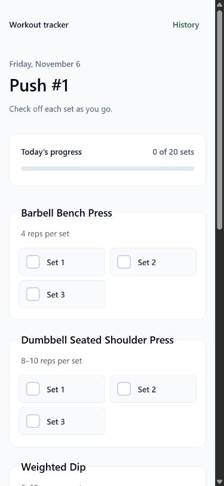
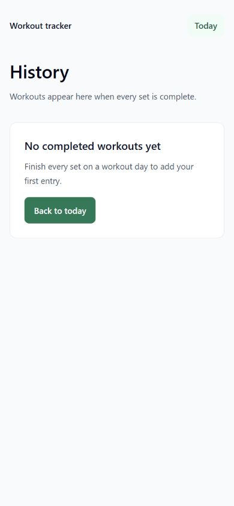

# Workout Tracker

A small Rails app for checking off sets at the gym. Open the home page for today's workout and target reps. Each checkbox saves on tap, and a workout appears in History when all its sets are checked. Each date gets a fresh checklist.

| Day | Workout |
| --- | --- |
| Monday | Rest |
| Tuesday | Push #2 |
| Wednesday | Legs #1 |
| Thursday | Pull #1 |
| Friday | Push #1 |
| Saturday | Legs #2 |
| Sunday | Pull #2 |

## Run locally

Use the Ruby version in `.ruby-version` and Bundler.

```sh
bundle install
bundle exec ruby bin/rails db:prepare
bundle exec ruby bin/rails server
```

Open [http://localhost:3000](http://localhost:3000). The app uses Eastern time by default. Set `WORKOUT_TIME_ZONE` to a Rails time zone name if needed.

## How it works

- `app/models/workout_routine.rb` maps weekdays to workouts and defines their exercises, sets, and reps.
- `WorkoutsController` renders today's checklist and validates each checkbox update against that day's routine.
- The Stimulus checklist controller saves each tap. If saving fails, it restores the previous checkbox state and displays an error.
- SQLite stores one row per checked set. History groups those rows by date and shows a workout once all of its sets are checked.

Run the test suite with `bundle exec ruby bin/rails test`.

## Use it on your phone

On a trusted home Wi-Fi network, run `bundle exec ruby bin/rails server -b 0.0.0.0` and open `http://<computer-LAN-IP>:3000` on your phone. Keep the computer running while you use it. This is a single-user app, and anyone who can reach the server shares the same checklist. Access from the gym requires hosting the app somewhere your phone can reach.

The personal routine was transcribed from Jeff Nippard's Legs/Push/Pull Hypertrophy Program, Week 5.

## Screenshots

| Today's checklist | History |
| --- | --- |
|  |  |